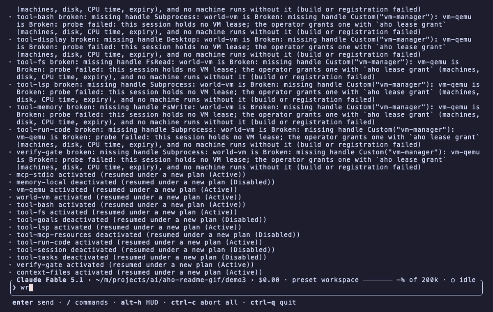
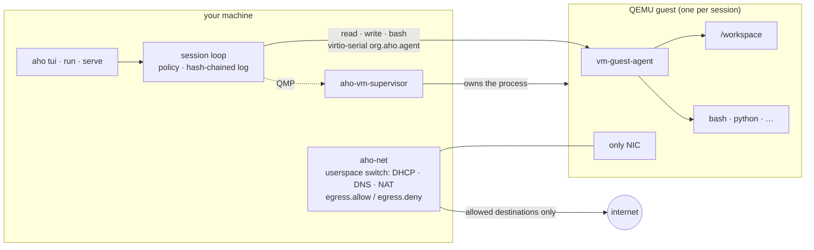

<p align="center">
  
</p>

<h1 align="center">aho</h1>

<p align="center">
  <b>A coding agent that works inside a VM, under a policy, on a log you can replay.</b>
</p>

<p align="center">
  <a href="https://github.com/matheusfrancisco/aho/actions/workflows/ci.yml"></a>
  
  
  
</p>

<p align="center">
  
</p>

<p align="center">
  <sub><code>aho tui --profile coding</code> with <code>seams.world = vm</code>: the file is written and the test is run inside a
  QEMU guest (<code>aho-dev</code>, Ubuntu 24.04, aarch64). Nothing the model asked for ran on the host.</sub>
</p>

---

aho is a modular Rust agent harness. The model can only *ask*; everything it asks for passes a
decision chain, runs in the world you chose, and lands in an append-only hash-chained log you can
verify, replay, fork and rewind.

- **Sandboxed by construction.** The agent's `read`/`write`/`bash` run in a QEMU VM, a Linux
  namespace, a remote host, or (policy only) on your machine. Sandbox worlds hold even against a
  maximally wrong agent.
- **Authority flows one way.** Presets, approvals and leases are operator acts; an agent-authored
  widening is unrepresentable in the type system, not merely denied.
- **One log, every view a fold.** `status`, `tree`, the request sent to the model, checkpoints,
  rewind: all derived from the same hash-chained JSONL. `aho session verify --formal` checks a
  log against the TLA+ specs in [`formal/`](formal/).
- **Capabilities, not forks.** Tools, guards, worlds, panels and hooks are `Capability` values
  in a `Composition`; turn them on, off, or replace them.

## Quick start

```sh
cargo install --locked --path apps/aho

aho login anthropic                      # or: aho login --list
aho set model.provider anthropic
aho set model.name claude-sonnet-4-5

cd ~/your/project
aho tui --profile coding                 # terminal UI with the coding tool set (33 tools, not 53)
aho run --profile coding -p "fix the failing test"   # one-shot
```

Ollama Cloud works the same way; `aho login ollama-cloud` prints a link to create a key, then you
paste it:

```sh
aho login ollama-cloud
aho set model.provider ollama-cloud
aho set model.name gemma4:31b
```

Model limits (output tokens, thinking budget, context window) come from the model catalog; set
`model.max_tokens` and friends only to override.

## The aho VM

The idea: the agent does not get a sandboxed *shell* on your machine, it gets a *machine*. With
`seams.world = vm` the session creates one sandbox VM from a typed recipe and every tool call
that touches files or processes crosses into it.



What this buys you:

| | |
|---|---|
| **Boundary** | QEMU guest. The host exposes only the agent channel, QMP and the supervisor; the guest's only NIC is `aho-net`. |
| **Network** | `aho-net` is a userspace switch per session: DHCP/DNS/NTP/NAT, port maps, session isolation, and the shared egress list. A blocked flow names its unlock (`aho net allow github.com`). |
| **Lease** | No machine runs without an operator lease: `aho lease grant --expires 6h` names machines, disk, CPU time and expiry. The supervisor keeps it expiring while no aho process runs; revocation is proven by the next use being refused. |
| **Recipe** | `aho add recipe` is typed: no raw QEMU arguments, no extra devices, no host mounts, no second NIC. Media are immutable (`aho media import`). |
| **Results** | `aho export ./src ./out` copies files out; `aho net map 8080:3000` reaches a guest port; `aho sandbox status` shows the machine; `aho sandbox destroy` discards it. |

The same substrate also powers the **VM lab** (`tool-vm`): there the VM is an *object* the agent
works **on** through 13 `vm_*` tools (create/start/stop, disks, console, screenshot,
keyboard/mouse) while the session stays in its own world. In the **vm world** the VM is the
*place* the agent works **in**. [docs/worlds.md](docs/worlds.md) has the full comparison.

### Setting it up

Requirements: QEMU ≥ 9.2 and `aho-vm-supervisor`. `scripts/vm-setup.sh` builds the whole setup
from a stock cloud image: prerequisite checks with exact fixes, the guest agent cross-compile,
seed, media import, recipe and config.

```sh
cargo install --locked --path crates/providers/world-vm --bin aho-vm-supervisor
scripts/vm-setup.sh --image ubuntu-24.04-server-cloudimg-arm64.img --smoke   # proves a boot + `aho shell`

aho set seams.world vm
aho set vm.recipe dev
aho shell -- true                          # creates the session; refuses: "no VM lease"
aho lease grant --expires 6h               # 2 machines, 40G disk, 6h CPU by default
aho tui --profile coding --session <id>    # first boot takes about a minute, then it persists
```

### The other worlds

| World | Set with | Enforced by |
|---|---|---|
| host | `aho set seams.world host` | policy only: the decision chain is a floor, not a sandbox |
| namespace (Linux) | `aho set seams.world namespace` | user/pid/mount/net namespaces, `aho-net` only NIC |
| vm | `aho set seams.world vm` + `aho set vm.recipe <recipe>` | QEMU guest boundary |
| ssh | `aho set seams.world ssh` | the remote host |

`--set seams.world=host` on any command switches for that one run only. When a world cannot come
up, `aho run` refuses with exit 2 and prints the world's error, which tools lost it, and the fix.

## Policy and authority

```sh
aho preset workspace        # default: read and write the workspace
aho preset read-only        # look only
aho preset dev              # + network
aho preset lab              # + VMs
aho allow tool-web          # let one capability's classes pass without asking
aho net allow github.com    # open one egress destination
```

Every tool call goes through the same chain, and steps 1–5 are never lifted by a later step:

```
1. deny rules   2. ask rules   3. tool.check   4. guards (deny-only)   5. safety checks
6. preset ceiling   7. allow rules   8. passthrough
```

`tool.check` for the shell is a blast-radius classifier: `Safe`/`Low` pass, `Confirm` raises an
approval card, `Catastrophic` is denied and never lifted. A subagent's policy is
`parent ⊓ declaration`; it can never exceed its parent. Repo text (`AGENTS.md` and friends) is
context, never authority. A denied call says why and names the exact unlock.

## Rewind, replay, verify

Every turn leaves a checkpoint. `aho checkpoints` lists them; `aho rewind c3` restores chat and
code, `--chat` only the conversation, `--code` only the files. The old branch is kept, nothing is
deleted; `aho fork --at <entry>` branches on purpose.

Every request logs `request_hash = hash(derive_messages(fold(prefix)), tools_visible)`.
`aho session verify` re-derives it for every header, so a session file proves what the model was
shown; `--formal` additionally checks the log as a behaviour of the TLA+ specs.

## In the TUI

| Key | Does |
|---|---|
| Enter | send; while the agent works, the text is queued as a steer for its next step |
| Alt+Enter | urgent steer: interrupts the step as soon as possible |
| Esc | close a menu or overlay first; otherwise stop the current turn (background jobs keep running) |
| Ctrl+C | stop everything, background jobs included |
| Ctrl+Q | quit; the session keeps its log |
| Alt+H | show or hide entry ids and origins |
| a / s / r / p | on an approval card: allow once / allow for the session / reject / switch preset |

Type `/` for commands: `/help`, `/tree` (capabilities and fixes), `/inventory`, `/jobs`,
`/invariants`, `/rewind`, `/hud`, `/thinking`, `/preset <name>`, `/plan`, `/quit`.
The abort keys are rebindable: `aho set tui.keys.abort_turn esc`, `tui.keys.abort_all ctrl+c`.

## Tips

- **Put your conventions in `AGENTS.md` or `CLAUDE.md`.** aho sends them to the model every step
  and re-reads them when they change.
- **Let aho check the work.** When a turn changed files, `verify-gate` runs your project's check
  before the turn may end (detected: `cargo test`, `npm test`, `pytest`, `go test`). Override with
  `aho set verify.command "make check"`, or `aho set verify.enabled false`.
- **Long work goes to the background.** The model can start a subagent, `bash` or `run_code` with
  `background: true` (and `bash` moves there by itself after 60 s). The turn ends, you keep
  talking, and each outcome arrives as a "Background job" notice.
- **When something is missing, ask aho why.** `aho status` shows the active world, policy and
  latest session; `aho why tool-bash` explains a capability's state and prints the exact fix;
  `aho explain model.max_tokens` shows where a setting's value came from.

## Commands

| Goal | Command |
|---|---|
| See what's on, what's locked and why | `aho status`, `aho plan`, `aho tree`, `aho why <capability>` |
| Change a setting | `aho set <key> <value>`, then `aho explain <key>` |
| Check a model provider | `aho doctor provider anthropic` |
| Resume a session | `aho tui --session <id>` or `aho run --session <id>` |
| List and inspect sessions | `aho session list`, `aho session show <id>` |
| Search every session in the project | `aho session query "a phrase" kind:tool_call tool:bash` |
| Prove a log is untampered and replayable | `aho session verify` (`--formal` checks it against the TLA+ specs) |
| Branch a session | `aho fork --at <entry>` |
| Background jobs | `aho jobs list`, `aho jobs kill <op>`, `aho jobs detach <op>` |
| Allow more concurrent jobs | `aho lease grant --jobs 16 --expires 6h` |
| Run one command as the operator, logged | `aho shell -- cargo test` |
| The sandbox VM | `aho sandbox status`, `aho sandbox destroy`, `aho export`, `aho net map` |
| Usage, latency and token stats | `aho stats` |
| Clean up leftovers | `aho gc` |

## Other ways to drive a session

- `aho serve --detach`: one daemon owns the project's sessions; `aho attach <session>` and
  several TUIs share it.
- `aho web`: the web UI (`aho cert` makes the local TLS pair).
- `aho acp`: Agent Client Protocol over stdio, for editors such as Zed.
- `aho rpc`: NDJSON rpc; generated TypeScript and Python SDKs live in [`sdk/`](sdk/).

## Extending

Implement `aho_cap::Capability` in a new crate and add it to a `Composition`; you never fork
aho. A capability can add tools, deny-only guards, hooks, context, panels, log entry kinds, or a
delivery step for background-job outcomes. See [docs/extending.md](docs/extending.md).

## How it works

```
aho-types                    leaf DTOs; no I/O
aho-log                      Entry/EntryKind, hash chain, fold, derive_messages
aho-cap · aho-config         Capability contract; layered config → Loadout
aho-policy                   principals, lattice, decide() chain, shell classifier
aho-session                  the loop: pure core + tokio driver
seams/                       traits + handle newtypes, no I/O
providers/ · tools/          one crate per backend
surfaces/                    print · rpc · tui · web · webhook · acp, all over one Session
bundles/                     products as Rust values (aho-base … aho-lab, aho-sdk)
apps/aho                     the CLI, linked against aho-lab
```

[docs/](docs/README.md) explains the architecture, authority, the session log, worlds, prompts
and the formal specs. Known gaps: [TODO.md](TODO.md). Direction: [ROADMAP.md](ROADMAP.md).

aho tells the model as little as possible and enforces the rest: checkable rules live in the
decision chain, guards and the session driver; facts are generated from live state; only
judgment ships as prose, pinned by the `prose` ratchet ([docs/prompts.md](docs/prompts.md)).

## Developing aho

```sh
cargo build -p aho                  # the CLI, linked against the aho-lab bundle
cargo test --workspace
scripts/gate.sh                     # fmt · clippy -D warnings · ratchets · layer guard
cargo run -p aho-sdk -- gen --check # generated TS/Python SDKs match the rpc protocol
```

- The egress allow/deny list lives at `egress.allow` / `egress.deny`, shared by web tools, MCP
  and the sandbox network. Tools have no per-tool list.
- A blocked flow's unlock names what blocked it: `aho net allow <dest>` for the egress list, and
  `aho net allow host-lan|other-sessions|internet` for an isolation rule.
- `scripts/evals/test-quality` is the operator-invoked real-model eval for judgment prose.
