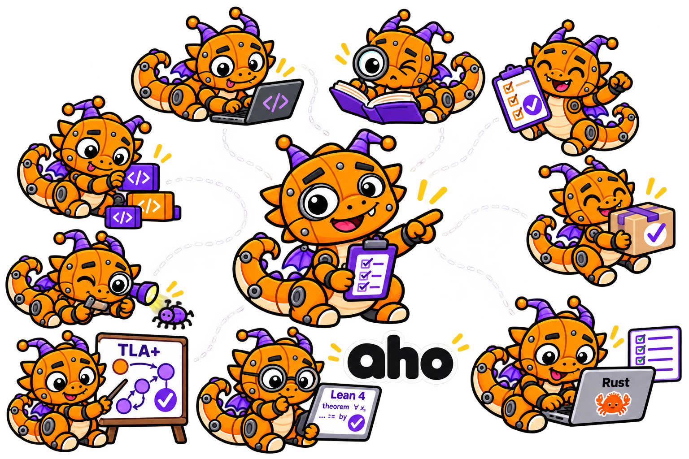

<p align="center">
  
</p>

# aho: a modular Rust agent harness

aho runs a coding agent where every tool call is checked against a policy, every action is a
hash-chained log entry you can replay and rewind, and the work can run on your machine or
inside a sandbox (Linux namespace, QEMU VM, or a remote host over ssh). Everything is a
capability you can turn on, off, or replace, without forking aho.

## Install

```sh
cargo install --locked --path apps/aho
cargo install --locked --path crates/providers/world-vm --bin aho-vm-supervisor   # only for the VM world
```

## First run

```sh
aho login anthropic                      # or: aho login --list
aho set model.provider anthropic
aho set model.name claude-sonnet-4-5
cd ~/your/project
aho tui --profile coding                 # the terminal UI with the coding tool set
```

One-shot instead of interactive: `aho run --profile coding -p "fix the failing test"`.

## Tips

- **Use `--profile coding` for coding.** It hides the non-coding tools (goals, schedules,
  ralph loops, task swarm, session search, memory), so the model sees 33 tools instead of 53.
  Your own `~/.aho/profiles/coding.toml` layers on top of it.
- **Put your conventions in `AGENTS.md` or `CLAUDE.md`.** aho sends them to the model as
  context every step and re-reads them when they change.
- **Let aho check the work.** When a turn changed files, `verify-gate` runs your project's
  check before the turn may end (detected: `cargo test`, `npm test`, `pytest`, `go test`).
  Override it with `aho set verify.command "make check"`, or turn it off with
  `aho set verify.enabled false`.
- **Don't fear mistakes; rewind.** Every turn leaves a checkpoint. `aho checkpoints` lists them;
  `aho rewind c3` restores chat and code, `--chat` the conversation only, `--code` the files only.
  The old branch is kept.
- **When something is missing, ask aho why.** `aho status` shows the active world, policy and
  latest session; `aho why tool-bash` explains a capability's state and prints the exact fix;
  `aho explain model.max_tokens` shows where a setting's value came from.
- **Model limits are automatic.** Output tokens, thinking budget and context window come from
  the model catalog; set `model.max_tokens` (or the others) only to override.
- **Long work goes to the background.** The model can start a subagent, `bash` or `run_code`
  with `background: true` (and `bash` moves there by itself after 60 s). The turn ends, you keep
  talking, and each outcome arrives as a "Background job" notice when it finishes, waking the
  session if it is idle.

## In the TUI

| Key | Does |
|---|---|
| Enter | send; while the agent works, the text is queued as a steer for its next step |
| Alt+Enter | urgent steer: interrupts the step as soon as possible |
| Esc | close a menu or overlay first; otherwise stop the current turn (background jobs keep running) |
| Ctrl+C | stop everything, background jobs included |
| Ctrl+Q | quit; the session keeps its log |
| Alt+H | show or hide entry ids and origins |
| a / s / r / p | on an approval card: allow once / allow for the session / reject / switch preset |

Type `/` for commands: `/help`, `/tree` (capabilities and fixes), `/inventory`, `/jobs`,
`/invariants`, `/rewind`, `/hud`, `/thinking`, `/preset <name>`, `/plan`, `/quit`.
The abort keys are rebindable: `aho set tui.keys.abort_turn esc`, `tui.keys.abort_all ctrl+c`.

## Where the agent works: worlds

| World | Set with | Boundary |
|---|---|---|
| host | `aho set seams.world host` | policy only: the decision chain, no kernel sandbox |
| namespace (Linux) | `aho set seams.world namespace` | user/pid/mount/net namespaces |
| vm | `aho set seams.world vm` + `aho set vm.recipe <recipe>` | a QEMU guest |
| ssh | `aho set seams.world ssh` | a remote host |

`--set seams.world=host` on any command switches for that one run only.

**Using the VM world.** A VM runs only under a lease you grant per session:

```sh
aho shell -- true                          # creates the session; refuses with "no VM lease"
aho lease grant --expires 6h               # 2 machines, 40G disk, 6h CPU by default
aho tui --profile coding --session <id>    # first boot takes about a minute
```

`scripts/vm-setup.sh --image <cloud-image> --smoke` builds the whole VM setup from a stock
cloud image. Copy results out with `aho export ./src ./out`; reach a guest port with
`aho net map 8080:3000`.

## Policy

```sh
aho preset workspace        # default: read and write the workspace
aho preset read-only        # look only
aho preset dev              # + network
aho preset lab              # + VMs
aho allow tool-web          # let one capability's classes pass without asking
aho net allow github.com    # open one egress destination (the blocked flow names its unlock)
```

The agent can only ask; authority comes from you. A denied call says why and how to unlock it.

## Best commands

| Goal | Command |
|---|---|
| See what's on, what's locked and why | `aho status`, `aho plan`, `aho tree`, `aho why <capability>` |
| Change a setting | `aho set <key> <value>`, then `aho explain <key>` |
| Check a model provider | `aho doctor provider anthropic` |
| Resume a session | `aho tui --session <id>` or `aho run --session <id>` |
| List and inspect sessions | `aho session list`, `aho session show <id>` |
| Search every session in the project | `aho session query "a phrase" kind:tool_call tool:bash` |
| Prove a log is untampered and replayable | `aho session verify` (`--formal` checks it against the TLA+ specs) |
| Branch a session | `aho fork --at <entry>` |
| Background jobs | `aho jobs list`, `aho jobs kill <op>`, `aho jobs detach <op>` |
| Allow more concurrent jobs | `aho lease grant --jobs 16 --expires 6h` |
| Run one command as the operator, logged | `aho shell -- cargo test` |
| Usage, latency and token stats | `aho stats` |
| Clean up leftovers | `aho gc` |

## Other ways to drive a session

- `aho serve --detach`: one daemon owns the project's sessions; `aho attach <session>` and
  several TUIs share it.
- `aho web`: the web UI (`aho cert` makes the local TLS pair).
- `aho acp`: Agent Client Protocol over stdio, for editors such as Zed.
- `aho rpc`: NDJSON rpc; generated TypeScript and Python SDKs live in `sdk/`.

## Extending

You extend aho by implementing `aho_cap::Capability` in a new crate and adding it to a
`Composition`; you never fork aho. A capability can add tools, deny-only guards, hooks,
context, panels, log entry kinds, or a delivery step for background-job outcomes. See
[docs/extending.md](docs/extending.md).

## How it works

[docs/](docs/README.md) explains the architecture, authority, the session log, worlds, prompts
and the formal specs. Known gaps: [TODO.md](TODO.md). Direction: [ROADMAP.md](ROADMAP.md).

aho tells the model as little as possible and enforces the rest: checkable rules live in the
decision chain, guards and the session driver; facts are generated from live state; only
judgment ships as prose, pinned by the `prose` ratchet ([docs/prompts.md](docs/prompts.md)).

## Developing aho

```
cargo build -p aho                  # the CLI, linked against the aho-lab bundle
cargo test --workspace
scripts/gate.sh                     # fmt · clippy -D warnings · ratchets · layer guard
cargo run -p aho-sdk -- gen --check # generated TS/Python SDKs match the rpc protocol
```

- The egress allow/deny list lives at `egress.allow` / `egress.deny`, shared by web tools, MCP
  and the sandbox network's seed. Tools have no per-tool list.
- A blocked flow's unlock names what blocked it: `aho net allow <dest>` for the egress list, and
  `aho net allow host-lan|other-sessions|internet` for an isolation rule.
- `scripts/evals/test-quality` is the operator-invoked real-model eval for judgment prose.
